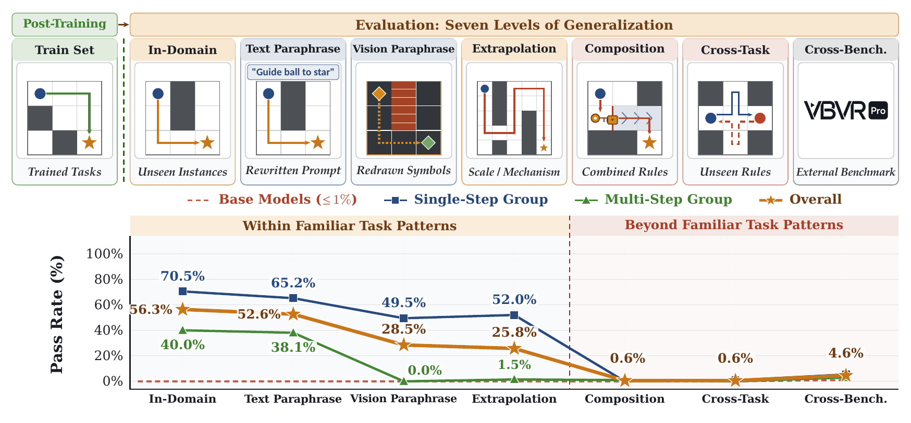
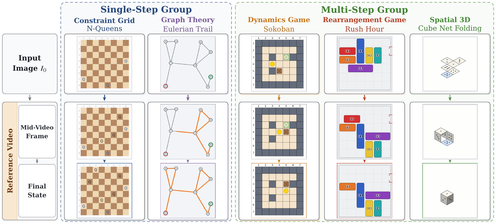
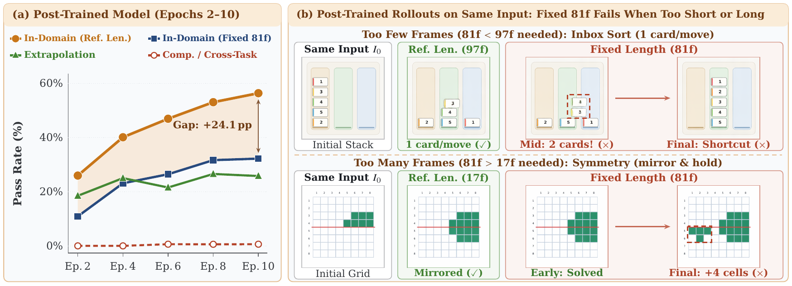
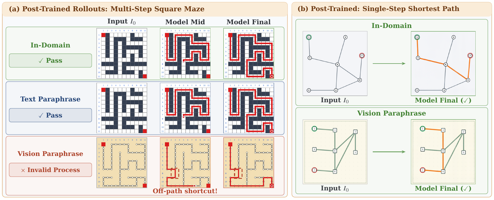
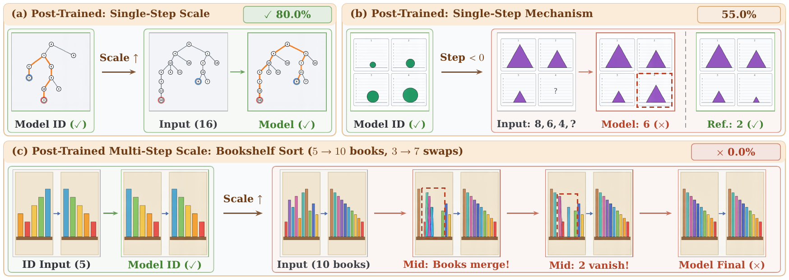
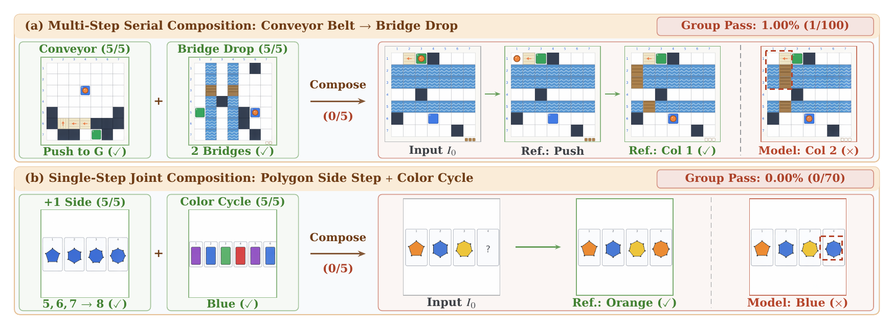
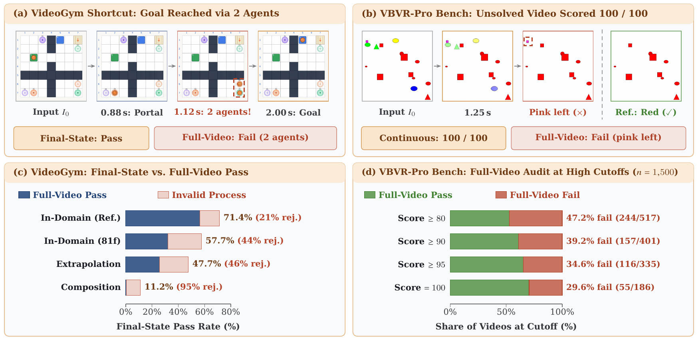

<div align="center">

# Can Video Generation Models Really Learn to Reason?

<p align="center">
  
  
  <a href="https://videogym.github.io/VideoGym/"></a>
  <br>
  <a href="https://huggingface.co/datasets/OpenMOSS-Team/VideoGym-Train"></a>
  <a href="https://huggingface.co/datasets/OpenMOSS-Team/VideoGym-Test"></a>
  <a href="https://huggingface.co/OpenMOSS-Team/VideoGym-LTX-2.3"></a>
  <a href="LICENSE"></a>
</p>

[**Overview**](#overview) · [**Benchmark**](#benchmark) · [**Results**](#results) · [**Quick Start**](#quick-start) · [**Evaluation**](#evaluation) · [**Inference & Training**](#models) · [**Website**](#project-page) · [**Citation**](#citation)

</div>

---

<p>
  
  <sub><b>Figure 1. VideoGym Overview and Main Results.</b> <b>(Top)</b> Given an initial image <i>I</i><sub>0</sub> and rules, a model generates a full solution video across seven generalization levels: <i>within familiar task patterns</i> evaluates unseen instances of trained tasks (<i>In-Domain</i>), synonymous prompt rewrites (<i>Text Paraphrase</i>), redrawn symbols with identical structure (<i>Vision Paraphrase</i>), and larger scale or boundary cases (<i>Extrapolation</i>); <i>beyond familiar task patterns</i> combines separately learned rules (<i>Composition</i>), introduces unseen rules in the same categories (<i>Cross-Task</i>), and transfers to VBVR-Pro Bench (<i>Cross-Benchmark</i>). <b>(Bottom)</b> Reference Length pass rates of post-trained <b>VideoGym-LTX-2.3</b> versus three base models (dashed: 0.00% on VideoGym-Test, ≤ 1.00% on VBVR-Pro Bench).</sub>
</p>

<a id="overview"></a>

## 🔎 Overview

**VideoGym** is an end-to-end open-source codebase and benchmark suite for studying whether post-training (SFT and RLVR) turns pretrained video generation models from **visual renderers** (turning stated scene descriptions into frames) into **visual reasoners** (given an initial image <i>I</i><sub>0</sub>, rules, and a goal with the answer unknown, working out valid intermediate states and a final answer). Solving new instances of a trained task can simply replay a learned solution pattern; genuine visual reasoning should extend **beyond single familiar task patterns** by combining mastered rules (`Composition`) and showing nontrivial transfer to unseen rules in the same problem categories (`Cross-Task`).

<div style="overflow-x: auto;">

| Component | Scale | Role in VideoGym |
| :--- | :--- | :--- |
| **Task&nbsp;Synthesis** | 245,884&nbsp;videos | 246 procedural generators in [`data/`](data/) synthesizing (<i>I</i><sub>0</sub>, <i>P</i>) and 16 FPS reference videos (**VideoGym&#8209;Train**) |
| **Benchmark&nbsp;Suite** | 3,720&nbsp;questions | 7 generalization levels in [`evaluation/`](evaluation/): 3,220 **VideoGym&#8209;Test** (6 levels) and 500 **VBVR&#8209;Pro Bench** questions |
| **Full&#8209;Video&nbsp;Verifiers** | 8,880&nbsp;controls | 100% accuracy on constructed positive/negative controls; 98.75% and 97.48% human audit agreement |
| **Models&nbsp;&&nbsp;Training** | 6&nbsp;models | Base, SFT, and SFT + RLVR rollout backends in [`inference/`](inference/), plus Diffusers SFT & FlowGRPO RLVR in [`training/`](training/) |

</div>

<a id="benchmark"></a>

## 🎯 Benchmark & Full-Video Verification

### Task Groups & Seven Progressive Levels

VideoGym divides its 246 In-Domain tasks across 11 task families into two groups by rule-defined visual execution ("single-step" and "multi-step" describe visual execution rather than internal search depth or frame count):

<div style="overflow-x: auto;">

| Task&nbsp;Group | In&#8209;Domain | Rule-Defined Visual Execution |
| :--- | :--- | :--- |
| **Single&#8209;Step&nbsp;Group** | 132&nbsp;(53.66%) | Marks one fixed answer on an unchanging puzzle (e.g., N-Queens, Eulerian trail) or applies one simultaneous update; progressive stroke drawing never alters the puzzle state. |
| **Multi&#8209;Step&nbsp;Group** | 114&nbsp;(46.34%) | Executes sequential state transitions or chained transforms (e.g., Sokoban, mazes, Rush Hour, 3D net folding), where each stage updates the visual state for the next. |

</div>

<details>
<summary><b>View Figure 2 & In-Domain breakdown across all 11 task families</b></summary>
<br>

<p>
  
  <sub><b>Figure 2. Representative In-Domain Tasks in VideoGym.</b> Each column shows the input image <i>I</i><sub>0</sub> (top) and two ground-truth reference keyframes (mid-video and solved final state). <b>Single-Step Group (left)</b> marks one fixed answer on an unchanging scene: <i>N-Queens</i> places one non-attacking queen per open row, and <i>Eulerian Trail</i> traces every edge once from the green start node to the red goal node. <b>Multi-Step Group (right)</b> executes sequential state updates where each move alters the scene for the next: <i>Sokoban</i> moves the yellow agent to push the brown box onto the green target, <i>Rush Hour</i> slides blocking cars along their axes so the red car exits right, and <i>Cube Net Folding</i> folds five numbered flaps upward one crease at a time onto the blue base into a closed cube.</sub>
</p>

Group membership across all seven levels (414 task entries) is recorded in [`data/common/task_groups.json`](data/common/task_groups.json) and documented in [`evaluation/catalog/task_groups.md`](evaluation/catalog/task_groups.md).

<div style="overflow-x: auto;">

| Family | Single | Multi | Total | Representative Tasks & Domains |
| :--- | ---: | ---: | ---: | :--- |
| **Geometry** | 72 | 4 | **76** | Euclidean constructions, loci, projections, inversions, and chained transforms |
| **Next&nbsp;State&nbsp;Prediction** | 8 | 24 | **32** | Cellular automata, state machines, BFS frontiers, and discrete grid rollouts |
| **Spatial&nbsp;Navigation** | 0 | 31 | **31** | Mazes, keys/locks, bridges, portals, conveyors, and resource routing |
| **Rearrangement&nbsp;Game** | 0 | 23 | **23** | Bookshelf sorting, Hanoi, pancake flips, crane stacks, and buffer queues |
| **In&#8209;Context&nbsp;Learning** | 16 | 3 | **19** | Visual analogies, attribute progressions, set operations, and matrix rules |
| **Graph&nbsp;Theory** | 17 | 0 | **17** | Shortest paths, tree diameter, LCA, bridges, Eulerian trails, bipartiteness |
| **Dynamics&nbsp;Game** | 1 | 13 | **14** | Sokoban, Breakout, Snake, match-clear cascades, and Lemmings rollouts |
| **Constraint&nbsp;Grid** | 13 | 0 | **13** | N-Queens, Star Battle, Akari, Slitherlink, Shikaku, Nurikabe, Masyu, Yin–Yang |
| **Board&nbsp;Game** | 1 | 7 | **8** | Go capture search, Mancala, Gomoku, Lights Out, and knight tours |
| **Physics** | 1 | 6 | **7** | Multi-mirror ray tracing, elastic collisions, spill cascades, and gear trains |
| **Spatial&nbsp;3D** | 3 | 3 | **6** | Cube-net folding, polycube rotations, orthographic views, and cross-sections |
| **Total** | **132** | **114** | **246** | **11 families spanning static answers and sequential state transitions** |

</div>

</details>

Using disjoint evaluation seeds (5 questions per task across all levels, plus a 4× 20-question-per-task expansion on `Extrapolation`, `Composition`, `Cross-Task`, and matched In-Domain source tasks), evaluation spans **seven progressive levels** defined relative to `VideoGym-Train`:

<div style="overflow-x: auto;">
<table>
  <thead>
    <tr>
      <th align="left">Level</th>
      <th align="right">Tasks</th>
      <th align="right">Questions</th>
      <th align="left">Evaluation Design (Relative to VideoGym-Train)</th>
    </tr>
  </thead>
  <tbody>
    <tr>
      <td colspan="4" align="left"><b>Within Familiar Task Patterns:</b> <i>Single trained task under unseen seeds, reworded text, redrawn symbols, or larger scale and boundary cases</i></td>
    </tr>
    <tr>
      <td><a href="evaluation/in_domain/catalog.py"><b>In&#8209;Domain</b></a></td>
      <td align="right">246</td>
      <td align="right">1,230</td>
      <td>Unseen problem instances within trained task patterns and parameter ranges</td>
    </tr>
    <tr>
      <td><a href="evaluation/prompt_paraphrase/README.md"><b>Text&nbsp;Prompt&nbsp;Paraphrase</b></a></td>
      <td align="right">246</td>
      <td align="right">1,230</td>
      <td>Synonymous instruction rewrites on the exact same 1,230 In&#8209;Domain problems</td>
    </tr>
    <tr>
      <td><a href="evaluation/prompt_paraphrase/vision_prompt_paraphrase/README.md"><b>Vision&nbsp;Prompt&nbsp;Paraphrase</b></a></td>
      <td align="right">33</td>
      <td align="right">165</td>
      <td>Redrawn visual symbols and prompt updates keeping the exact same problem and answer</td>
    </tr>
    <tr>
      <td><a href="evaluation/extrapolation/README.md"><b>Extrapolation</b></a></td>
      <td align="right">52</td>
      <td align="right">260</td>
      <td>Larger grids, objects, or steps (<b>29 Scale</b>) or unseen rule boundary cases (<b>23 Mechanism</b>)</td>
    </tr>
    <tr>
      <td colspan="4" align="left"><b>Beyond Familiar Task Patterns:</b> <i>Decisive reasoning tests across rule composition, unseen rules, and cross-suite transfer</i></td>
    </tr>
    <tr>
      <td><a href="evaluation/composition/README.md"><b>Composition</b></a></td>
      <td align="right">34</td>
      <td align="right">170</td>
      <td>Serial chaining or joint combination of 2–3 rules taught only in separate tasks</td>
    </tr>
    <tr>
      <td><a href="evaluation/cross_task/README.md"><b>Cross&#8209;Task</b></a></td>
      <td align="right">33</td>
      <td align="right">165</td>
      <td>Unseen tasks introducing new rules in the same 11 problem categories as training</td>
    </tr>
    <tr>
      <td><a href="evaluation/cross_benchmark/vbvr_pro/relations.toml"><b>Cross&#8209;Benchmark</b></a></td>
      <td align="right">100</td>
      <td align="right">500</td>
      <td>Transfer from VideoGym to the full <b>VBVR&#8209;Pro Bench</b> under full-video verification</td>
    </tr>
  </tbody>
</table>
</div>

### Deterministic Full-Video Verification

In video tasks, intermediate frames are part of the solution rather than hidden scratch work. Every `VideoGym-Test` and `VBVR-Pro Bench` task pairs with a deterministic frame-by-frame verifier that accepts alternative valid solutions and awards a **Full-Video Pass** only when three checks hold together: (1) **Valid Video Format** (`media_contract`: clean 512×512, 16 FPS decoding at the target frame count), (2) **Valid Full-Video Process** (`whole_video_process`: legal step-by-step execution without shortcuts, duplicated objects, or extra post-solve edits), and (3) **Valid Final State** (`video_final_state`: solved ending matching the task goal). Verifiers reach **100% accuracy** across **8,880** constructed test videos (7,880 VideoGym + 1,000 VBVR-Pro Bench), with **98.75%** (395/400) and **97.48%** (116/119; **100.00%** under Reference Length) agreement in blinded human audits.

<a id="results"></a>

## 📊 Key Findings

> **Main conclusion:** Current video generation models, which lack sufficient pretraining for visual reasoning, **cannot really learn to reason** through post-training (i.e., acquire **generalizable reasoning**). Open-weights base video models score 0.00% pass@1 across `VideoGym-Test` (≤ 1.00% on `VBVR-Pro Bench`). Post-training brings clear gains *within familiar task patterns* (concentrated in the Single-Step Group), yet models collapse near 0% *beyond familiar task patterns* across tested backbones, datasets, and SFT or two-stage SFT + RLVR recipes, even when every constituent rule is solved at 100% accuracy on its own. Instead of really learning to reason, post-trained video models replay familiar solution patterns and remain **visual renderers** rather than **visual reasoners**.

All models generate pass@1 videos directly from (<i>I</i><sub>0</sub>, <i>P</i>) without external LLM/VLM prompt rewriting.

### 1. Within Familiar Task Patterns: Static Gains, Pace Fitting & Visual Symbol Fragility

Evaluating **VideoGym-LTX-2.3** against all three base models (`LTX-2.3`, `Wan2.2-I2V-A14B`, `Wan2.2-TI2V-5B`):

<div style="overflow-x: auto;">

| Level | Duration | Qs | Overall | Single&#8209;Step | Multi&#8209;Step |
| :--- | :--- | ---: | ---: | ---: | ---: |
| Base&nbsp;Models&nbsp;(all&nbsp;3) | Ref.&nbsp;/&nbsp;81f | 3,220 | 0.00% | 0.00% | 0.00% |
| In&#8209;Domain | Fixed&nbsp;(81f) | 1,230 | 32.20% | 47.58% | 14.39% |
| **In&#8209;Domain** | **Ref.&nbsp;Length** | 1,230 | **56.34%** | **70.45%** | **40.00%** |
| Text&nbsp;Prompt&nbsp;Paraphrase | Ref.&nbsp;Length | 1,230 | 52.60% | 65.15% | 38.07% |
| Vision&nbsp;Prompt&nbsp;Paraphrase | Ref.&nbsp;Length | 165 | 28.48% | 49.47% | **0.00%** |
| Extrapolation | Ref.&nbsp;Length | 260 | 25.77% | 52.00% | **1.48%** |

</div>

- **Duration sensitivity (`Fixed Length` vs. `Reference Length`):** Because a Video DiT presets output frame count and denoises all frames jointly, switching from Reference Length to Fixed Length (81 frames) drops In-Domain pass rate from 56.34% to 32.20% and doubles invalid-process rejections among final-state passes (21.07% → 44.23%), triggering multi-object shortcuts when 81 frames is too short and post-solution over-painting when 81 frames is too long (widening from 15.0 to 24.1 pp across epochs 2–10).
- **Text robustness vs. visual symbol dependence (`Prompt Paraphrase`):** Synonymous rewrites retain 90.76% of solved In-Domain questions via frozen Gemma 3 language priors (60.00% vs. 60.61% on the 33-task matched subset), whereas redrawing visual symbols (`Vision Prompt Paraphrase`) drops to **0.00%** across all 14 Multi-Step Group tasks because the frozen pixel-level Video VAE and Video DiT fail to bind unfamiliar symbols to trained rules across sequential steps.
- **Scaling & boundary cases (`Extrapolation`):** On 100%-solved In-Domain source tasks, `Scale Extrapolation` retains 80.00% in the Single-Step Group yet collapses to **0.00% in the Multi-Step Group** (remaining 0.00% at 20 questions/task; merging and dropping books even with extra frames), while `Mechanism Extrapolation` (55.00% on 100%-solved Single-Step sources) replays dominant training trends when unseen cases depart from training (e.g., fading in a height-6 triangle instead of 2 on shrinking *Size Sequence* `8, 6, 4 → 2`).

<details>
<summary><b>View Figures 3–5: Post-trained duration sensitivity, Prompt Paraphrase, and Extrapolation rollouts</b></summary>
<br>
<p>
  
  <sub><b>Figure 3. Post-Training Across Epochs and Sensitivity to Preset Frame Count.</b> Video diffusion models preset output frame count before generation; we evaluate post-trained <b>VideoGym-LTX-2.3</b> given each problem's true solution length (<i>Reference Length</i>) versus a fixed 81-frame budget (<i>Fixed Length</i>). <b>(a)</b> Across epochs 2–10, the In-Domain gap widens to +24.1 pp as the model increasingly fits training-video pace while Extrapolation plateaus after epoch 4 and Composition/Cross-Task stay near 0%. <b>(b)</b> Paired post-trained rollouts on the exact same <i>I</i><sub>0</sub>: when 81 frames is shorter than needed (<i>Inbox Priority Sort</i>), the model illegally lifts two cards together; when 81 frames is longer than needed (<i>Symmetry Completion</i>), it finishes mirroring early and paints four extra cells.</sub>
</p>
<p>
  
  <sub><b>Figure 4. Post-Trained Rollouts under Prompt Paraphrase: Text Robustness vs. Visual Symbol Dependence.</b> Rollouts from post-trained <b>VideoGym-LTX-2.3</b> on matched problems. <b>(a)</b> On Multi-Step <i>Square Maze</i>, Text Prompt Paraphrase passes cleanly, whereas Vision Prompt Paraphrase (diamond stations and linked rails on the same grid) cuts across an unlinked gap (0.00% pass rate across all 14 Multi-Step Vision Paraphrase tasks). <b>(b)</b> On Single-Step <i>Shortest Path</i>, redrawing circular nodes into square terminals still transfers, matching Single-Step Vision Paraphrase retention (65.22% of solved In-Domain problems retained).</sub>
</p>
<p>
  
  <sub><b>Figure 5. Post-Trained Rollouts under Extrapolation.</b> Rollouts from post-trained <b>VideoGym-LTX-2.3</b> comparing solved In-Domain source instances (left) against Reference Length Extrapolation instances (right). <b>(a)</b> Single-Step Scale (<i>Tree Path</i>, 10 → 16 nodes) transfers cleanly (80.00% pass rate across Single-Step Scale tasks with 100%-solved In-Domain sources). <b>(b)</b> Single-Step Mechanism (<i>Size Sequence</i>) fails on an unseen negative step (8, 6, 4 → 2), fading in height 6 by replaying upward training growth (55.00% pass rate across Single-Step Mechanism tasks with 100%-solved sources, succeeding mainly when training trends still apply). <b>(c)</b> Multi-Step Scale (<i>Bookshelf Sort</i>, 5 → 10 books) merges and drops books mid-video before copying the target (0.00% pass rate across all Multi-Step Scale tasks).</sub>
</p>
</details>

### 2. Beyond Familiar Task Patterns: Collapse on Rule Composition, Unseen Tasks & External SFT/RLVR

`Composition` tests 2–3 rules already taught in `VideoGym-Train` on the exact same native canvas under strict ablation non-degeneracy (removing any constituent rule alters the valid answer). Multiplying constituent In-Domain pass rates per task predicts **60.8%** (∏<i>p<sub>i</sub></i>) under independent rule execution, yet post-trained `VideoGym-LTX-2.3` collapses across both groups even when every constituent task reaches **100%** In-Domain accuracy (across both 5 and 20 questions per task):

<div style="overflow-x: auto;">

| Constituent&nbsp;Filter | Qs | Overall | Single&#8209;Step | Multi&#8209;Step |
| :--- | ---: | ---: | ---: | ---: |
| All&nbsp;Tasks&nbsp;(5&nbsp;questions/task) | 170 | **0.59%** | 0.00% | 1.00% |
| Constituents&nbsp;≥&nbsp;80% | 110 | **0.91%** | 0.00% | 2.00% |
| **Constituents&nbsp;=&nbsp;100%** | 60 | **1.67%** | **0.00%** | **10.00%** |
| All&nbsp;Tasks&nbsp;(20&nbsp;questions/task) | 680 | **1.32%** | 0.71% | 1.75% |
| Constituents&nbsp;≥&nbsp;80%&nbsp;(20&nbsp;questions/task) | 340 | **2.35%** | 0.45% | 5.83% |
| **Constituents&nbsp;=&nbsp;100%&nbsp;(20&nbsp;questions/task)** | 200 | **4.00%** | **0.62%** | **17.50%** |

</div>

<p>
  
  <sub><b>Figure 6. Post-Trained Rule Composition Fails Across Both Groups.</b> Rollouts from post-trained <b>VideoGym-LTX-2.3</b> comparing constituent In-Domain tasks solved at 100% accuracy (left) against Reference Length Composition (right; 1.00% pass rate across all 20 Multi-Step and 0.00% across all 14 Single-Step Composition tasks): <b>(a)</b> serial Multi-Step (<i>Conveyor Belt</i> + <i>Bridge Drop</i>) ignores the conveyor push before bridging, and <b>(b)</b> joint Single-Step (<i>Polygon Side Step</i> + <i>Color Cycle</i>) updates polygon sides while ignoring the 3-color cycle.</sub>
</p>

To verify whether different backbones, 5× per-task data scale, or RLVR shift this boundary, we evaluate `VideoGym-LTX-2.3` alongside **VBVR-Pro A14B** (SFT) and **VBVR-Pro 5B RLVR** (two-stage SFT + DanceGRPO/CPS RLVR), both trained on the 1.25M-video VBVR-Pro dataset across 250 tasks ([`relations.toml`](evaluation/cross_benchmark/vbvr_pro/relations.toml)):

<div style="overflow-x: auto;">
<table>
  <thead>
    <tr>
      <th align="left">Evaluation&nbsp;Level</th>
      <th align="right">VideoGym&#8209;LTX&#8209;2.3</th>
      <th align="right">VBVR&#8209;Pro&nbsp;A14B</th>
      <th align="right">VBVR&#8209;Pro&nbsp;5B&nbsp;RLVR</th>
    </tr>
  </thead>
  <tbody>
    <tr>
      <td colspan="4" align="left"><i>Within Familiar Task Patterns (relative to each model's own training tasks)</i></td>
    </tr>
    <tr>
      <td>In&#8209;Domain</td>
      <td align="right">56.34%&nbsp;(693/1,230)</td>
      <td align="right">48.80%&nbsp;(122/250)</td>
      <td align="right">30.80%&nbsp;(77/250)</td>
    </tr>
    <tr>
      <td>Text&nbsp;Prompt&nbsp;Paraphrase</td>
      <td align="right">52.60%&nbsp;(647/1,230)</td>
      <td align="right">N/A</td>
      <td align="right">N/A</td>
    </tr>
    <tr>
      <td>Vision&nbsp;Prompt&nbsp;Paraphrase</td>
      <td align="right">28.48%&nbsp;(47/165)</td>
      <td align="right">20.00%<sup>†</sup>&nbsp;(5/25)</td>
      <td align="right">4.00%<sup>†</sup>&nbsp;(1/25)</td>
    </tr>
    <tr>
      <td>Extrapolation</td>
      <td align="right">25.77%&nbsp;(67/260)</td>
      <td align="right">29.23%&nbsp;(57/195)</td>
      <td align="right">14.36%&nbsp;(28/195)</td>
    </tr>
    <tr>
      <td colspan="4" align="left"><b>Beyond Familiar Task Patterns:</b> <i>Rule composition, unseen rules &amp; cross-suite transfer</i></td>
    </tr>
    <tr>
      <td><b>Composition</b></td>
      <td align="right"><b>0.59%&nbsp;(1/170)</b></td>
      <td align="right"><b>0.00%&nbsp;(0/20)</b></td>
      <td align="right"><b>0.00%&nbsp;(0/20)</b></td>
    </tr>
    <tr>
      <td><b>Cross&#8209;Task</b></td>
      <td align="right"><b>0.61%&nbsp;(1/165)</b></td>
      <td align="right"><b>0.00%&nbsp;(0/10)</b></td>
      <td align="right"><b>0.00%&nbsp;(0/10)</b></td>
    </tr>
    <tr>
      <td><b>Cross&#8209;Benchmark</b></td>
      <td align="right"><b>4.60%&nbsp;(23/500)</b></td>
      <td align="right"><b>1.77%&nbsp;(57/3,220)</b></td>
      <td align="right"><b>0.99%&nbsp;(32/3,220)</b></td>
    </tr>
  </tbody>
</table>
</div>

<sub>Reference Length pass@1. Rows above Cross-Benchmark evaluate each model relative to its own training set (VideoGym-Test vs. VBVR-Pro Bench); Cross-Benchmark tests transfer to the other suite. <sup>†</sup>Unpaired task-level visual variants in VBVR-Pro Bench.</sub>

- **Isolated trajectory templates rather than composable rules (`Composition`):** At 20 questions per task, **30 of 34** Composition tasks score 0% (7 of 10 on 100%-solved constituents), and even the nine passing videos across all 680 rollouts come from unactivated second rules, isolated single-question hits, or a single downward-conveyor layout.
- **Universal cliff on unseen rules (`Cross-Task` & external SFT/RLVR):** `VideoGym-LTX-2.3` scores **0.61%** on unseen rules in the same 11 categories (0.15% at 20 questions per task via a single center-cell shortcut, with 32 of 33 tasks at 0%). Likewise, 91.94% and 96.55% of VBVR-Pro A14B and 5B RLVR's out-of-domain passes come from `Extrapolation`, while **both score 0.00% on `Composition` and `Cross-Task`**, and symbol/convention differences cap `Cross-Benchmark` transfer at 0.99%–4.60%.
- **Why LLMs and video models diverge:** Unlike LLMs whose pretraining text/code priors are elicited by RLVR over hidden tokens, Video DiTs start at 0.00% pass@1 and jointly denoise visible frames in fixed steps; Stage-1 SFT memorizes separate task patterns and Stage-2 RLVR sharpens probability mass within them, pointing toward **reasoning pretraining** on explicit state transitions and multi-step interactions.

### 3. Why Loose Metrics Mistake Shortcuts for Reasoning

Prior studies reported higher out-of-domain scores (`35–70/100`) for two reasons: (1) out-of-domain splits are dominated by familiar-pattern `Extrapolation` (39 of 50 out-of-domain tasks in `VBVR-Pro Bench`), and (2) final-state-only and continuous `[0, 100]` partial-credit evaluators reward static backgrounds and illegal shortcuts. On `VideoGym-Test`, **94.74%** of `Composition` final-state passes violate intermediate rules (100% confirmed wrong by blinded human audit); across all 1,500 Reference Length post-trained `VBVR-Pro Bench` videos, **47.20%** scored ≥ 80 and **29.57%** awarded a perfect 100/100 by the upstream continuous evaluator fail full-video verification:

<p>
  
  <sub><b>Figure 7. Why Loose Metrics Mistake Post-Trained Shortcuts for Reasoning.</b> <b>(a)</b> On VideoGym Composition (<i>Portal + Conveyor</i>), post-trained <b>VideoGym-LTX-2.3</b> spawns two duplicate agents mid-video yet lands on G in the final frame. <b>(b)</b> On VBVR-Pro Bench (<i>Majority Color</i>), post-trained <b>VBVR-Pro 5B RLVR</b> leaves a pink square unremoved yet receives 100/100 under partial-credit pixel tolerances. <b>(c)</b> Splitting post-trained VideoGym-LTX-2.3 final-state passes (bar length) into full-video passes and invalid-process videos (parentheses: invalid share of final-state passes). <b>(d)</b> Full-video verification failure rates across VBVR-Pro continuous-score cutoffs.</sub>
</p>

---

## 🗂️ Repository Structure

```text
VideoGym/
├── cli.py                  Unified `videogym` CLI (`data`, `benchmark`, `training`)
├── data/                   246 procedural task generators across 11 task families
├── evaluation/             Seven-level suites, full-video verifiers & VBVR-Pro Bench
│   ├── catalog/            Per-level TOML configs, stratification & task_groups.md
│   ├── in_domain/          In-Domain evaluation catalog (246 tasks)
│   ├── prompt_paraphrase/  Paired Text (246) & Vision (33) Prompt Paraphrase suites
│   ├── extrapolation/      Scale (29) & Mechanism (23) Extrapolation suite
│   ├── composition/        Non-degenerate 2–3-rule Composition suite (34 tasks)
│   ├── cross_task/         Unseen-rule Cross-Task suite (33 tasks)
│   └── cross_benchmark/    VBVR-Pro Bench verifiers, out-of-domain split & scorer comparison
├── inference/              Native LTX-2.3, Wan2.2 / VBVR-Pro & Diffusers backends
├── training/               Diffusers SFT & FlowGRPO RLVR pipeline (LTX-2.3 & Wan2.2)
├── docs/                   Static GitHub Pages website (paper & task explorer)
└── tests/                  Generator, verifier, contract & website unit tests
```

<a id="quick-start"></a>

## 🚀 Installation & Quick Start

### 1. Environment Setup & Sanity Check

Create a **Python 3.12+** environment and install `videogym` in editable mode:

```bash
python3.12 -m venv .venv
source .venv/bin/activate
pip install -e .
videogym benchmark check-catalog
```

Generate three reproducible task instances (add `--video` to encode 16 FPS VP9 `.webm` reference videos; requires **FFmpeg with `libvpx-vp9`** and Pillow with Raqm text layout):

```bash
videogym data generate \
  --tasks angle_bisector \
  --count 3 --seed 42 --num-workers 1 --video \
  --output-root outputs/quickstart
```

### 2. Download or Synthesize Training Data (`VideoGym-Train`)

Download the official 245,884-video [`OpenMOSS-Team/VideoGym-Train`](https://huggingface.co/datasets/OpenMOSS-Team/VideoGym-Train) dataset from Hugging Face (and unpack Parquet shards into the local `families/` tree for `videogym` CLI commands), or synthesize new instances directly:

```bash
# Download official VideoGym-Train and unpack media for CLI training/profiling
hf download OpenMOSS-Team/VideoGym-Train --repo-type dataset --local-dir datasets/videogym-train
python datasets/videogym-train/unpack.py --dataset-dir datasets/videogym-train --workers 16

# Or synthesize multi-family training data from scratch
videogym data generate \
  --task-families geometry spatial_navigation graph_theory \
  --count 1000 --seed 42 --num-workers 16 \
  --video \
  --output-root outputs/videogym-train
```

Omit `--video` to emit prompt, input-image, and ground-truth state records without rendering SFT target videos. All 246 generators are registered in [`data/registry.py`](data/registry.py).

<a id="evaluation"></a>

## ✅ Benchmark Generation & Full-Video Evaluation

### 1. Download, Build, and Score `VideoGym-Test` Packages

Download the frozen 6-level, 3,220-question [`OpenMOSS-Team/VideoGym-Test`](https://huggingface.co/datasets/OpenMOSS-Team/VideoGym-Test) benchmark directly (`hf download OpenMOSS-Team/VideoGym-Test --repo-type dataset --exclude "data/*" --local-dir datasets/videogym-test`), or regenerate packages from a training profile, audit zero training overlap, and run parallel CPU full-video verification (tasks with rendered numeric graph badges use **Tesseract 5** via `brew install tesseract` or `apt-get install tesseract-ocr tesseract-ocr-eng`; override binary path via `TESSERACT_CMD`):

```bash
# 1. Profile training membership and parameter support
videogym benchmark profile \
  --manifest <videogym-train>/canonical_manifest.jsonl --all-training-rows \
  --dataset-name videogym-train --output <training-profile.json>

# 2. Generate 5-question/task In-Domain package (or pass extrapolation/composition/cross_task.toml)
videogym benchmark generate \
  --training-profile <training-profile.json> \
  --config evaluation/catalog/default.toml --tracks id \
  --count-per-task 5 --output-root <in-domain-package>
videogym benchmark audit --dataset <in-domain-package>

# 3. Optional: generate a separate 20/task robustness-audit expansion from a 5/task package
videogym benchmark generate \
  --training-profile <training-profile.json> \
  --config evaluation/catalog/composition.toml \
  --extend-from <composition-n5-package> --count-per-task 20 \
  --output-root <composition-n20-package>

# 4. Score generated model videos with deterministic full-video verifiers
videogym benchmark score \
  --dataset <benchmark-package> --predictions-root <rollouts-dir> \
  --model videogym-ltx-2.3 --output-root <scores-dir> --workers 16
```

Level-specific preparation and control suites: [Text&nbsp;Prompt&nbsp;Paraphrase](evaluation/prompt_paraphrase/README.md) · [Vision&nbsp;Prompt&nbsp;Paraphrase](evaluation/prompt_paraphrase/vision_prompt_paraphrase/README.md) · [Extrapolation](evaluation/extrapolation/README.md) · [Composition](evaluation/composition/README.md) · [Cross&#8209;Task](evaluation/cross_task/README.md).

### 2. Cross-Benchmark Evaluation (`VBVR-Pro Bench`)

`evaluation/cross_benchmark/vbvr_pro/` provides deterministic full-video verifiers across all 100 VBVR-Pro Bench tasks, the training-relative out-of-domain classification ([`relations.toml`](evaluation/cross_benchmark/vbvr_pro/relations.toml)), and paired continuous-vs-full-video comparison utilities. Benchmark data retains its [upstream license notice](evaluation/cross_benchmark/vbvr_pro/NOTICE.md).

```bash
# Download, prepare public inputs + Reference Length sidecar, and run 1,000 positive/negative controls
videogym benchmark vbvr download --output <vbvr-source>
videogym benchmark vbvr prepare --manifest <vbvr-source>/manifest.jsonl --output-root <vbvr-package>
videogym benchmark vbvr controls --gt-root <vbvr-source> --output <vbvr-controls> --workers 16

# Score candidate rollouts under deterministic full-video verification
videogym benchmark vbvr score \
  --dataset <vbvr-package> --predictions <rollouts-dir> \
  --output <scores-dir> --workers 16

# Optional: run upstream continuous evaluator & pair against full-video verdicts
videogym benchmark vbvr score-continuous \
  --strict <scores-dir>/scores.jsonl --upstream <vbvr-pro-bench-repo> \
  --gt-root <vbvr-source> --output <continuous-scores.json> --workers 16
python -m evaluation.cross_benchmark.vbvr_pro.comparison \
  --pair <model-name> <continuous-scores.json> <scores-dir>/scores.jsonl \
  --output <continuous-comparison.json>
python -m evaluation.cross_benchmark.vbvr_pro.discrimination \
  --pair <model-name> <continuous-scores.json> <scores-dir>/scores.jsonl \
  --output <scorer-discrimination.json>
```

<a id="models"></a>

## 🧠 Inference & Post-Training

<div style="overflow-x: auto;">

| Backbone | Evaluated&nbsp;Models | Rollout&nbsp;Backend (`inference/`) |
| :--- | :--- | :--- |
| **LTX&#8209;2.3&nbsp;(22B)** | `LTX-2.3`&nbsp;(Base), **VideoGym&#8209;LTX&#8209;2.3**&nbsp;(SFT) | `inference.backends.ltx`&nbsp;(`--base`,&nbsp;`--checkpoint`) |
| **Wan2.2&#8209;I2V&#8209;A14B** | `Wan2.2-I2V-A14B`&nbsp;(Base), `VBVR-Pro A14B`&nbsp;(SFT) | `inference.backends.wan`&nbsp;(`a14b-base`,&nbsp;`a14b`) |
| **Wan2.2&#8209;TI2V&#8209;5B** | `Wan2.2-TI2V-5B`&nbsp;(Base), `VBVR-Pro 5B RLVR`&nbsp;(RLVR) | `inference.backends.wan`&nbsp;(`5b-base`,&nbsp;`5b-rlvr`) |

</div>

Install optional GPU training/inference dependencies with `pip install -e '.[training]'` (custom Diffusers SFT and FlowGRPO RLVR adapters across all three backbones run via `training/` and `inference.backends.trained_adapter`). Native LTX-2.3 rollout inference (`inference.backends.ltx`) additionally requires Lightricks' upstream `ltx-core` package installed in the environment.

### 1. Run Rollout Inference (`Reference Length` vs. `Fixed Length`)

Download [`OpenMOSS-Team/VideoGym-LTX-2.3`](https://huggingface.co/OpenMOSS-Team/VideoGym-LTX-2.3) (`hf download OpenMOSS-Team/VideoGym-LTX-2.3 --local-dir models/VideoGym-LTX-2.3`), export or reuse `reference-timing.jsonl` (containing only `id`, `frames`, and `fps`, without any reference pixels or answers) for Reference Length, or pass `--frames 81` for Fixed Length (81f):

```bash
python -m inference.data.timing \
  --dataset <benchmark-package> --output <reference-timing.jsonl>

# Evaluate VideoGym-LTX-2.3 (or pass --model-path <ltx-2.3-diffusers> --base for base LTX-2.3)
python -m inference.backends.ltx \
  --inputs <benchmark-package>/model_inputs.jsonl \
  --reference-timing <reference-timing.jsonl> \
  --model-path models/VideoGym-LTX-2.3 \
  --output-root <rollouts-dir> --shards 8 --shard-index 0 --device cuda:0

# Evaluate Wan2.2 / VBVR-Pro models (--model a14b | 5b-rlvr | a14b-base | 5b-base)
python -m inference.backends.wan \
  --model a14b --inputs <benchmark-package>/model_inputs.jsonl \
  --reference-timing <reference-timing.jsonl> --model-path <wan-or-vbvr-weights> \
  --output-root <rollouts-dir> --shards 8 --shard-index 0 --device cuda:0
```

### 2. Custom Post-Training with Diffusers SFT & FlowGRPO RLVR

**VideoGym-LTX-2.3** in our paper is trained via native full-DiT SFT on `VideoGym-Train` from `ltx-2.3-22b-dev` across 28 `8k+1` frame buckets (25–241 frames) at 768×512 (24 FPS, freezing the Gemma 3 text encoder, text connectors, and Video VAE; AdamW with linear LR `1e-5` → `1e-6`, audio loss disabled, 10 epochs on 32 H200 GPUs). Because base video models score 0.00% pass@1 across `VideoGym-Test` (causing severe reward sparsity for RLVR from base) and online video rollouts across 246 tasks on a 22B backbone are computationally prohibitive, our paper evaluates two-stage SFT + RLVR via `VBVR-Pro 5B RLVR` (DanceGRPO + CPS). For custom post-training experiments across LTX-2.3 and Wan2.2, `training/` provides a unified Diffusers-based SFT and FlowGRPO RLVR pipeline (full-parameter or LoRA with DDP/FSDP), paired with `python -m inference.backends.trained_adapter`:

```bash
videogym training export-data \
  --manifest <canonical_manifest.jsonl> --output <train.jsonl> --samples-per-task 1000

videogym training launch \
  --config training/configuration/presets/wan_ti2v.toml \
  --manifest <train.jsonl> --output-dir <sft-run> \
  --tuning full --sharding fsdp --processes 8

videogym training launch \
  --config training/configuration/presets/wan_ti2v.toml \
  --manifest <train.jsonl> --output-dir <rl-run> \
  --stage flow_grpo --warm-start <sft-run>/adapter \
  --tuning full --sharding fsdp --processes 8
```

Presets are located in [`training/configuration/presets/`](training/configuration/presets/).

<a id="project-page"></a>

## 🌐 Project Website

[`docs/`](docs/) powers the live [**VideoGym Project Website**](https://videogym.github.io/VideoGym/), presenting the paper overview, synchronized multi-model rollout comparisons (30 cases, 118 videos) across all empirical findings, and an integrated **Task Explorer** covering all seven generalization levels (744 evaluation task entries, <i>I</i><sub>0</sub> inputs, exact prompts <i>P</i>, and H.264 reference videos).

```bash
# Preview the static website locally at http://127.0.0.1:8000
python3 -m http.server -d docs 8000
```

<a id="development"></a>

## 🧪 Development & Verification

Run static checks, catalog verification, and the full regression suite from the repository root:

```bash
pip install -e '.[dev]'
videogym benchmark check-catalog
python -m pytest -q
node --test tests/website/test_metrics.cjs
```

<a id="citation"></a>

## 📝 Citation

If you find **VideoGym** useful in your research, please consider starring this repository and citing our paper:

```bibtex
@article{chen2026videogym,
  title={Can Video Generation Models Really Learn to Reason?},
  author={Chen, Hongji and Tong, Jingqi and Li, Hangcheng and Li, Mingzhe and Mou, Yurong and Yang, Yongzhuo and Zhang, Haowei and Wang, Zile and Xie, Zhide and Qiu, Shenling and Chen, Ke and Hu, Xiaomeng and Li, Chenglin and Dou, Shihan and Deng, Hokin and Zheng, Yining and Ho, Tsung-Yi and Zhao, Jun and Chen, Xinchi},
  journal={arXiv preprint},
  year={2026}
}
```

## 📄 License

Original code in this repository is released under the [Apache-2.0 License](LICENSE). Bundled fonts and adapted VBVR-Pro Bench materials retain their respective upstream terms ([`NOTICE.md`](evaluation/cross_benchmark/vbvr_pro/NOTICE.md)).
